# 潮汐方舟 · Tide Ark

> **水不该是用来收费的东西。**

一款为 Rokid AI 眼镜（AIUI，单色绿光 480×352）设计的末世漂流生存经营游戏。四个键打完全程：上、下、确认、返回。

<p align="center">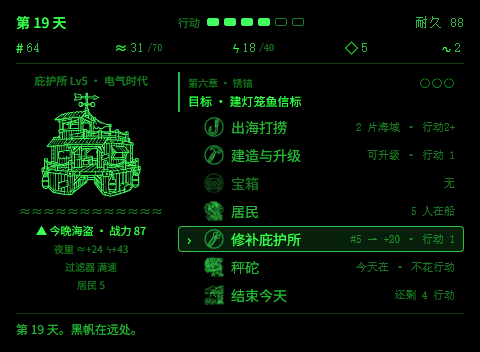</p>

---

## 目录

- [序章 · 深蓝纪元](#序章--深蓝纪元)
- [第一幕 · 活下去](#第一幕--活下去)
- [第二幕 · 站起来](#第二幕--站起来)
- [第三幕 · 方舟](#第三幕--方舟)
- [海上的人](#海上的人)
- [海上的日子](#海上的日子)
- [漂流瓶](#漂流瓶)
- [怎么玩、怎么跑](#怎么玩怎么跑)

---

## 序章 · 深蓝纪元

公元 2147 年，海平面失控上涨。

最先没的是海边的城市，然后是平原，再然后是那些建在平原上的工厂。人们原本以为水会停下来，但它没有停。等到最后一座山顶也只剩下一圈礁石时，幸存的人开始从头数年份，把之后的日子叫作**深蓝纪元**。

<p align="center"></p>

大淹没之后，海上最值钱的东西不是金子，也不是燃料，而是**能喝的水**。

几座高塔改成的「海上城邦」结成联盟，垄断了淡水厂，给每个登记在册的人发配给。配给不是白给的：每一份都要付「配给费」，欠了就记账，账记满了就盖章。

深蓝纪元 183 年，你又欠了三期。

配给官**白砂**坐在高塔的窗口后面，翻过你的账本，没有抬头。

> 「淡水配给费，又欠了三期。」
> 「规则不是我定的，但我执行它。」

他在你的名字上盖了章。

第二天，城邦给了你一块木筏、几根废料和一台坏掉的过滤器，然后把你推向外海。

没人觉得你能活过一周。

---

## 第一幕 · 活下去

### 第一章 · 第一口淡水

木筏很小，小到躺下就能摸到两边的海水。过滤器是坏的，你身上只有一个钩索。

所以你做了外海每个人都会做的事：**出海打捞**。

<table>
<tr>
<td>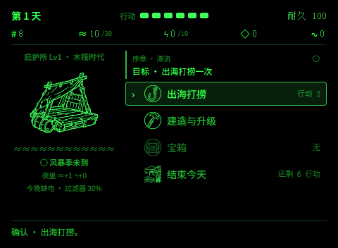</td>
<td>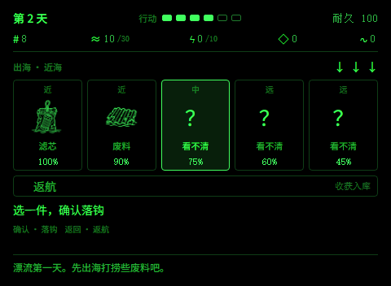</td>
</tr>
<tr>
<td align="center">第 1 天。木筏、三钩、一台缺电的过滤器，一天 6 点行动力。</td>
<td align="center">近处两件看得清、稳稳到手；远处是「？」，可能是好东西，也可能是巨鲨。</td>
</tr>
</table>

海面上漂着旧世界的残渣：废料、塑料水瓶、生锈的零件，偶尔还有一只箱子。你捞到的第一枚滤芯外壳都锈了，芯子却还是好的。你把它装进过滤器，等了很久。

过滤器滴下了第一滴干净的水。

你想起白砂盖章的样子，忽然明白了一件事：**水，原来是可以自己造的。**

<table>
<tr>
<td>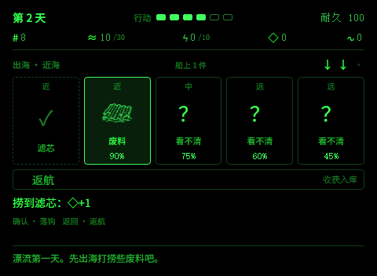</td>
<td>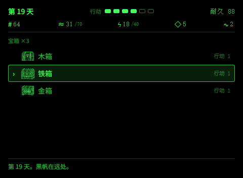</td>
</tr>
<tr>
<td align="center">钩中了。东西先放船上，返航才入库：见好就收，还是再赌一钩？</td>
<td align="center">捞上来的箱子，花 1 点行动力打开。</td>
</tr>
</table>

第二天，海上漂来一只集装箱。你把它拖上木筏，撬开门，里面滚出来一个人。

<p align="center"></p>

她叫**铆钉**，原来是城邦的维修工。城邦的配给阀坏了，总得有人背锅，于是她被锁进集装箱，扔进了海里。

> 「你这木筏，钉子全钉歪了。」
> 「让我来。能拆的就能装回去。」

从那天起，木筏上有了第二个人，钉子也终于钉直了。

### 第二章 · 电与光

过滤器要电，电从哪里来？

答案在网里噼啪作响。被旧世界实验改造过的**电鳗**在近海游荡，身上的电够点亮一整座庇护所。

第五天，你捞到一只漂流采样舱。舱里是个昏迷的女人，怀里护着一本潮湿的笔记本。她醒来说的第一句话是：

> 「电鳗还活着吗？」

她叫**珊瑚**，是研究会的海兽学者。研究会要把这些电鳗做成一次性电池，她把样本偷了出来，一路逃到外海。

> 「它们不是怪物，是被逼着变的。」

在珊瑚的照看下，第一台电鳗发电机建成了。那天晚上，木筏上亮起了第一盏灯。

远处有船在看你们。

铆钉说：「从今晚起，我们是海上的一颗星了。」

<p align="center">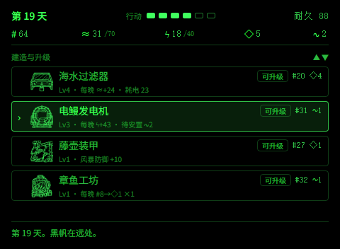</p>

### 第三章 · 风暴季

珊瑚注意到海鸟都往南飞了。

> 「每隔三晚，潮水会来一次大的。」

风暴季开始了。主界面左侧多了一行预报，提前告诉你是哪一晚、会掉多少耐久。

<table>
<tr>
<td>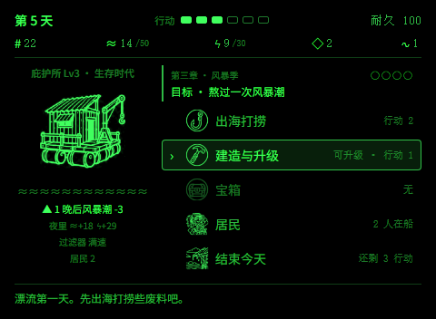</td>
<td>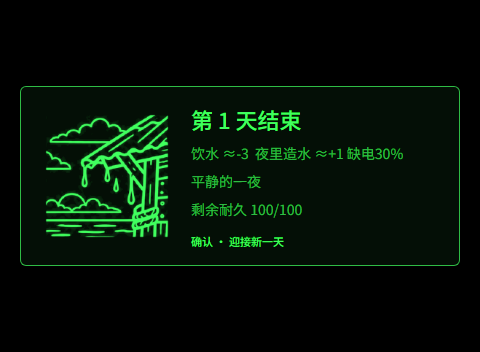</td>
</tr>
<tr>
<td align="center">「1 晚后风暴潮」——还来得及补一层。</td>
<td align="center">每天结束：喝水、算伤、看明天。</td>
</tr>
</table>

第一次挨过风暴潮的那个早上，补丁还在。铆钉在木板上划了一道：

> 「下次，让它连补丁都碰不到。」

珊瑚教你们在船底养**藤壶**：它们会自己长，越长越厚，比任何钢板都扛得住潮。

风暴过后漂来一条小舢板，上面的人举着一口锅大喊：

> 「别开枪！我只带了一口锅！」
> 「城邦后厨不要我了，说我偷喝了汤。我就喝了一口！」

他叫**小锅**。他会用海藻熬汤，汤淡一点，水就省一点。

---

## 第二幕 · 站起来

### 第四章 · 新的邻居

庇护所升到第五层的那一夜，几条小船悄悄靠了过来。

他们都是被城邦赶出来的人：欠费的、背锅的、说错话的。他们看见了你的灯。

你的木筏，开始像一座城了。

人群里有一个扛着钢梁的沉默男人。他走上甲板，把你的地基量了三遍，只说了一句：

> 「能盖七层。」

他叫**铁梁**，只相信量过三遍的数字。

几天后，一条挂满秤砣的船停在了外面。流动商人**秤砣**做的是所有人的生意，包括城邦的。他精明，但守信。

> 「废料换滤芯，淡水换电鳗。」
> 「价格从不便宜，货从不掺假。三天后见。」

<table>
<tr>
<td>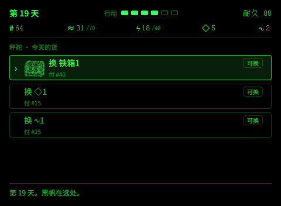</td>
<td>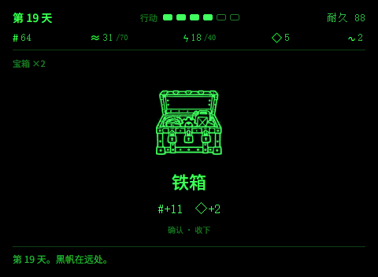</td>
</tr>
<tr>
<td align="center">秤砣每三天来一次，每笔交易当天限一次。</td>
<td align="center">铁箱里常有滤芯，金箱一定有电鳗。</td>
</tr>
</table>

铆钉和珊瑚为要不要让章鱼进工坊吵了一整晚，最后章鱼赢了：它拧螺丝比铆钉还快。

### 第五章 · 远海

一只大海龟停在了庇护所旁，背上坐着个木腿老头。

> 「这片海，我在上面开过车。」

他叫**灯塔叔**。大淹没之前，他是跑长途的司机，脚下这片海原来是一条高速公路。

> 「近海早被捞空了。往北，是旧城的残骸带。给海龟套上拖架，我带路。」

<p align="center">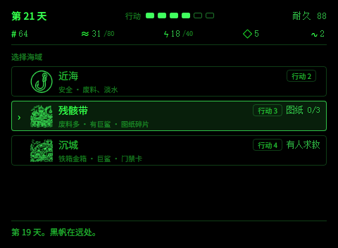</p>

残骸带里，半截高楼从水里伸出来，楼顶还挂着旧世界的广告牌。东西多，危险也多：被改造过的**巨鲨**藏在远处的「？」里，钩中它会多扯断一钩，还会叼走船上一半的收获。

<p align="center">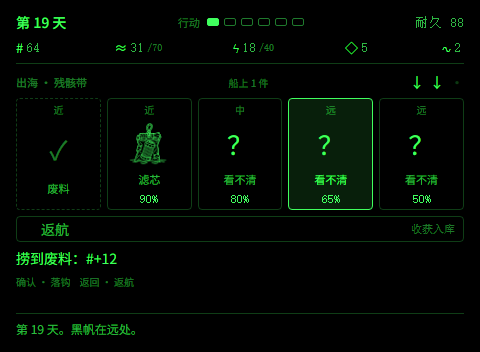</p>

你在残骸带捞到三片泡烂的工程图，拼起来是一台电鳗发电机，只是比你们的大一百倍。

图纸角落盖着一个波浪形的印章：**深蓝计划**。签名只有一个字：林。

### 第六章 · 锈锚

灯塔叔放下望远镜。

> 「锈锚的船。他闻到灯光了。」

**锈锚**是外海最有名的海盗。黑帆、铁钩，专挑亮着灯的庇护所。三晚之后，他来了。

<p align="center">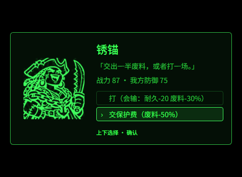</p>

> 「强者拥有一切。这话是城邦教我的。」
> 「交出一半废料，或者打一场。」

确认是打，返回是交。

如果你的防御够高，黑帆会退到射程外，挂出一面白旗。锈锚上船谈判，说出了另一个被盖过章的故事：

> 「十年前，白砂也给我盖过章。」
> 「你造你的城，我不碰。但哪天你要去找城邦算账——叫我。」

---

## 第三幕 · 方舟

### 第七章 · 沉没实验室

庇护所升到第七层，进入工业时代的那天，城邦的信鸽落在了吊臂上。

> 「你的庇护所未经登记，须缴纳淡水税。——白砂」

你没有回信。

图纸上的坐标指向海底的一座穹顶。灯塔叔说那地方灯照下去都会被吃掉。海龟拖船升到第二级后，你们第一次到了**沉城**。

在沉城的第一趟，你捞上来一根断掉的气管。管子另一头拴着一个戴铜盔的潜水员：打捞公司把他丢在了下面。

> 「……我还能下去。我认得路。」

他叫**气泡**。他怕黑，但从来不承认。

沉城里的东西也跟着你浮了上来。从此每个风暴夜，都会有巨型章鱼的触手拍打船体。

<table>
<tr>
<td></td>
<td>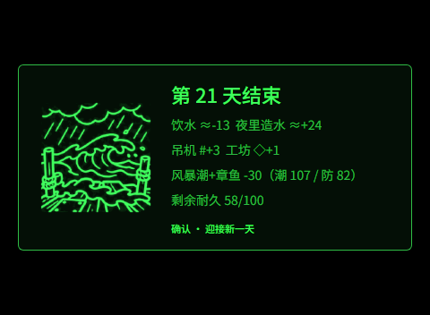</td>
</tr>
<tr>
<td align="center">沉城解锁后，风暴潮伤害 +20%。</td>
<td align="center">潮 94，防 82：这一晚掉了 14 耐久。</td>
</tr>
</table>

气泡在沉城捞到一张门禁卡，上面印着「深蓝计划 · 潮汐组」。

> 「门还通电。下面有人。」

<details>
<summary><b>实验室里的真相（剧透）</b></summary>

<br>

穹顶里有一个气泡舱，一个老人坐在发光的屏幕前。

> 「……终于有人来了。」

他是**林博士**，深蓝计划的研究员，也是那张图纸上的签名。

> 「深蓝计划有两部分。一是让人适应海洋——二是让海水变成免费的淡水。」

舱角坐着一个颈侧有鳃的人，说话像潮声。他叫**潮生**。

> 「我是第一部分。」
> 「第二部分，被城邦沉进了海底。」

第二部分叫**潮汐引擎**。它能把海水直接变成淡水，多到喝不完。

大淹没之后，城邦拿走了档案，把引擎图纸封进了这座实验室。

理由很简单：**免费的水，就收不到水费了。**

</details>

### 第八章 · 方舟

> 林博士：「方舟要装下引擎，你的庇护所必须升到最后一层。」
> 铁梁：「能盖。」

铁梁还是只说了两个字。但他量地基，从来不量第四遍。

<details>
<summary><b>结局（剧透）</b></summary>

<br>

方舟建成了。引擎转动，海水变成淡水，多到装不下。它已经能抵御任何风暴潮。

然后，城邦的船停在了方舟外面。白砂站在船头。

> 「把图纸交给联盟，你可以回城，免除全部欠费。」

<p align="center">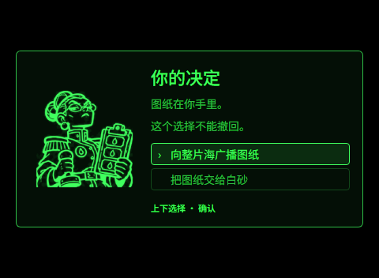</p>

**确认：向整片海广播图纸。**
每一条漂流的船都收到了图纸。白砂沉默了很久，摘下了配给官的徽章。

**返回：把图纸交给白砂。**
你住进了城邦最高的那层楼。水费照收。窗外，有人在木筏上看着你。

这个选择不能撤回。

无论选哪一个，潮生都会在最后出现：

> 「海还在涨。」
> 「深蓝计划的第二阶段，已经启动了。」

**—— 第一幕完 · 可继续漂流 ——**

<p align="center">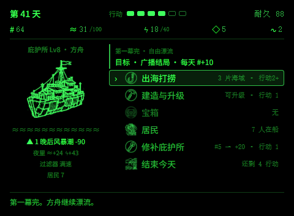</p>

</details>

---

## 海上的人

几乎每一个上了你木筏的人，都是被同一套水费制度甩出来的。全身立绘、台词和加成见《[角色图鉴](docs/图鉴.md)》。

| 角色 | 从前 | 一句话 | 擅长海域 |
|---|---|---|---|
| **你**（老潮） | 欠费三期的打捞工 | 不说话。别人叫你老潮，因为你总能在潮水退了以后还站着。 | — |
| **铆钉** | 城邦维修工，替配给阀背锅 | 「能拆的东西，就能装回去。」 | 残骸带 |
| **珊瑚** | 研究会叛逃的海兽学者 | 「它们不是怪物，是被逼着变的。」 | 近海 |
| **小锅** | 城邦后厨帮工，「偷喝了一口汤」 | 「饿着肚子什么都想不明白。」 | 近海 |
| **铁梁** | 建筑师，被赶出来的邻居之一 | 「能盖七层。」 | 残骸带 |
| **灯塔叔** | 大淹没前跑长途的司机，木腿 | 「这底下原来是高速公路。」 | 残骸带 |
| **锈锚** | 海盗首领，十年前被盖过章 | 「海上没规则，只有约定。」 | 沉城 |
| **气泡** | 被打捞公司丢在海底的潜水员 | 「沉城的路我闭眼也认得。」 | 沉城 |
| **秤砣** | 流动商人，不入住 | 「价格从不便宜，货从不掺假。」 | — |
| **林博士** | 深蓝计划研究员 | 疲惫，愧疚。 | — |
| **潮生** | 深蓝计划「适应体」 | 说话像潮声。 | — |
| **白砂** | 城邦配给官 | 「规则不是我定的，但我执行它。」 | — |

### 派他们出海，或者找他们聊聊

人多了，你不必每一趟都亲自出海。居民可以替你去：派谁、去哪由你决定，带回来什么由海决定。派人不花你的行动力，但每人要带 2 份淡水当口粮；他们第二天早上回来，收获写进当晚的结算。去自己擅长的海域会多带一件，好感到三颗以上再多带一件。

<table>
<tr>
<td>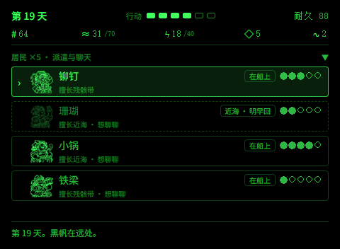</td>
<td>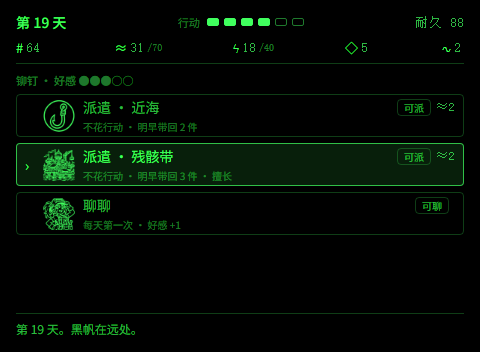</td>
</tr>
<tr>
<td align="center">谁在船上、谁在海上、好感几颗心。</td>
<td align="center">铆钉擅长残骸带：明早带回 3 件。</td>
</tr>
<tr>
<td>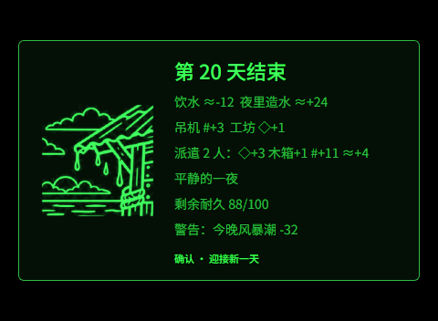</td>
<td>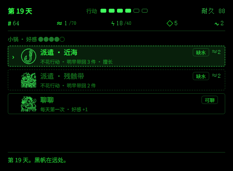</td>
</tr>
<tr>
<td align="center">出海的人明早回来，收获并进结算。</td>
<td align="center">水不够，谁也出不了海。</td>
</tr>
</table>

闲下来的时候，可以找他们说句话。平常他们聊自己的事；要是今晚有风暴或者海盗，他们会先提醒你。

<table>
<tr>
<td>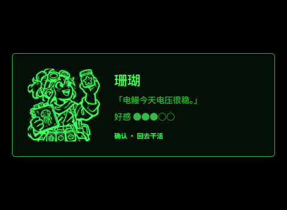</td>
<td>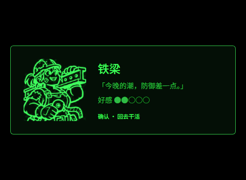</td>
</tr>
<tr>
<td align="center">珊瑚：「电鳗今天电压很稳。」</td>
<td align="center">铁梁：「今晚的潮，防御差一点。」</td>
</tr>
</table>

在 AIUI 眼镜上，如果大模型可用，居民会根据当天的处境换一句自己的话，并用各自的音色读出来。大模型只负责说话，收获和好感都由游戏规则算好；模型不可用时，用写好的台词，游戏完全离线可玩。

---

## 海上的日子

一天有 **6 点行动力**。没有倒计时，想好了再动：

| 行动 | 行动力 |
|---|---|
| 出海：近海 / 残骸带 / 沉城 | 2 / 3 / 4 |
| 建造升级、修补、开箱 | 1 |
| 下潜实验室 | 2 |
| 派人出海、聊天、交易 | 不花 |

行动力用完，焦点会跳到「结束今天」；也可以提前结束。天黑时结算：

1. **喝水**：人越多，喝得越多。缺一份水掉 6 点耐久。
2. **夜里的活**：电鳗发电，过滤器造水（电不够就减产，最低三成）；寄居蟹吊机捞废料，章鱼工坊造滤芯。
3. **今晚是什么夜**：平静夜、风暴潮夜、海盗夜，三选一。

庇护所从木筏一路升到方舟，经过四个时代：

| 时代 | 等级 | 你在做什么 |
|---|---|---|
| 木筏 | Lv1–2 | 活过第一周，造出第一口淡水 |
| 生存 | Lv3–4 | 点亮第一盏灯，熬过风暴季 |
| 电气 | Lv5–6 | 收留邻居，去远海，对付黑帆 |
| 工业 → 方舟 | Lv7–8 | 下潜沉城，装上潮汐引擎 |

耐久归零，庇护所就沉了。可以从当天早上重来，也可以从头开始；返回键不会替你选。

<p align="center">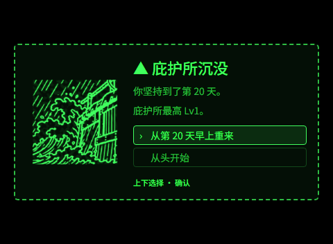</p>

---

## 漂流瓶

打捞时偶尔会捞到一只漂流瓶。里面是其他漂流者写下的一句话，你永远不知道是谁写的。

<p align="center">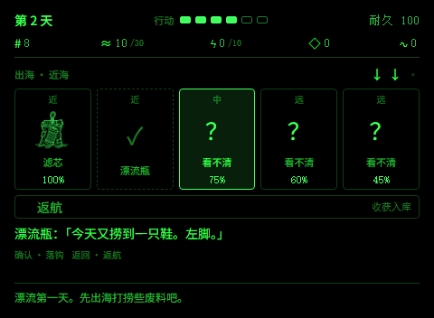</p>

> 今天又捞到一只鞋。左脚。
>
> 谁有滤芯？换一条鱼。
>
> 孩子问我陆地长什么样。
>
> 海鸥偷了我的午饭。
>
> 第 300 天，还活着。
>
> 如果你读到这个，往东有淡水。
>
> 我把房子拆了，造了船。
>
> 城邦的灯，晚上真好看。
>
> 别吃那种发光的鱼。
>
> 我们会再见到陆地的。

---

## 怎么玩、怎么跑

### 四个键

| 键 | 眼镜手势 | 作用 |
|---|---|---|
| 上 / 下 | 镜腿前滑 / 后滑 | 移动焦点 |
| 确认 | 单击 | 进入、落钩、开箱、关弹窗；有选项的弹窗里确认当前选项 |
| 返回 | 返回 | 回上一级；打捞中提前返航（船上的收获照样入库）。海盗、终章、沉没这类有选项的弹窗不响应返回 |

### 在浏览器里预览

```bash
npm run preview
```

打开 http://localhost:5178/preview/ ，用键盘 ↑ ↓ Enter Backspace 操作。想直接看某个界面，可以在地址后加 `?scene=16-mate` 这样的场景名。

### 测试与截图

```bash
npm test
```

```bash
node tools/shots.mjs
```

截图会重新生成到 [docs/screenshots/](docs/screenshots/README.md)，全部 28 张也打包在 [tide-ark-screenshots.zip](docs/screenshots/tide-ark-screenshots.zip)。

### 文档

| 文件 | 内容 |
|---|---|
| [docs/故事.md](docs/故事.md) | 剧情脚本：每个弹窗的台词都以这里为准 |
| [docs/图鉴.md](docs/图鉴.md) | 角色图鉴：12 位角色的 2.5D 全身立绘、身份、台词、加成 |
| [docs/系统设计.md](docs/系统设计.md) | 章节、设施、居民、海域、夜间事件的规则和数值 |
| [docs/交互设计.md](docs/交互设计.md) | 四键流程、每个界面、居民派遣与聊聊 |
| [docs/AIUI能力调研.md](docs/AIUI能力调研.md) | AIUI 大模型、语音、存储的能力与限制 |

### 代码

| 路径 | 内容 |
|---|---|
| `agent/core/game.js` | 全部游戏逻辑，不依赖平台 API |
| `agent/pages/index/index.ink` | AIUI 页面：渲染、按键、可选的大模型与语音 |
| `preview/` | 浏览器里的简化 AIUI 运行时，和截图用的固定场景 |
| `tests/game.test.mjs` | 逻辑测试 |

---

<p align="center"><i>潮水退了以后，你还站着。</i></p>
