# 潮汐方舟 · 界面截图

由 `node tools/shots.mjs` 生成：每张图来自 `preview/scenes.js` 里的一个固定场景，在浏览器预览里按眼镜画布 480×352 截取。
真机显示以 AIUI 模拟器 / Rokid 眼镜为准。交互说明见 [交互设计](../交互设计.md)。

| 场景 | 说明 | 截图 |
|---|---|---|
| 01-prologue | 序章剧情弹窗（第一次打开） |  |
| 02-home-ch1 | 主界面 · 第一章 | 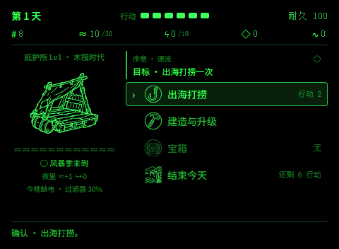 |
| 03-home-storm | 主界面 · 风暴预报（第三章） | 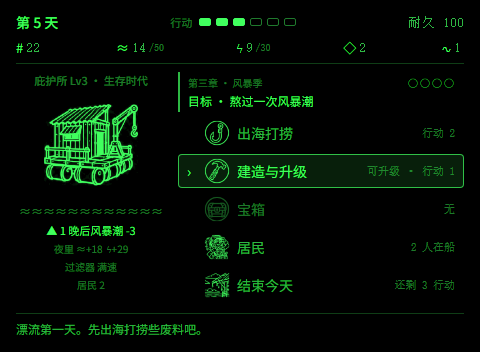 |
| 04-home-late | 主界面 · 居民 + 商人（6 项，紧凑行） | 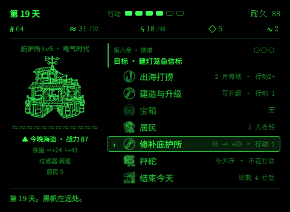 |
| 05-story-rivet | 剧情弹窗 · 说话人立绘 |  |
| 06-zones | 选择海域 | 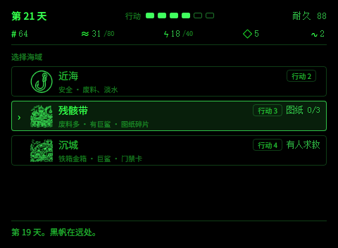 |
| 07-salvage | 打捞 · 选目标（近处看得清，远处是「？」） | 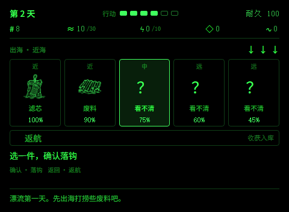 |
| 08-salvage-hit | 打捞 · 钩中一件，见好就收？ | 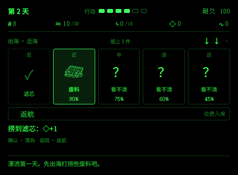 |
| 09-salvage-letter | 打捞 · 漂流瓶 | 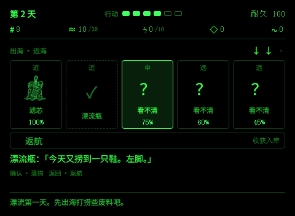 |
| 10-salvage-wreck | 打捞 · 残骸带 | 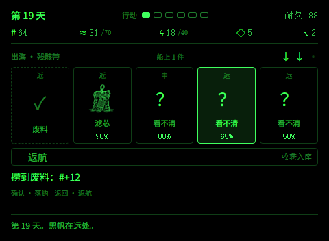 |
| 11-build | 建造与升级（滚动列表） | 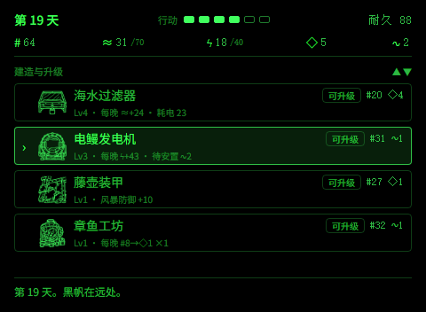 |
| 12-chests | 宝箱列表 | 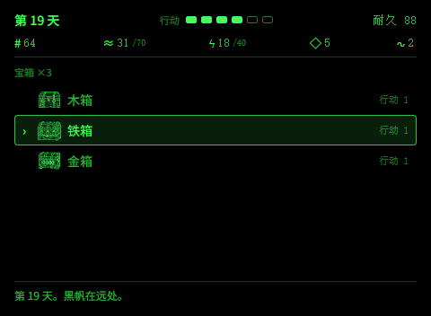 |
| 13-chest-open | 开箱 | 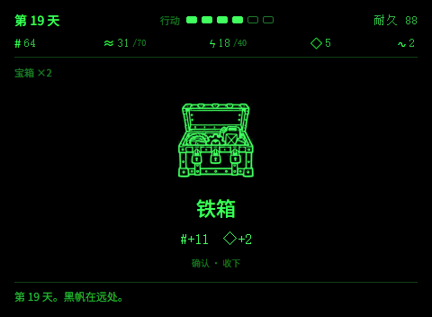 |
| 14-trade | 商人秤砣 | 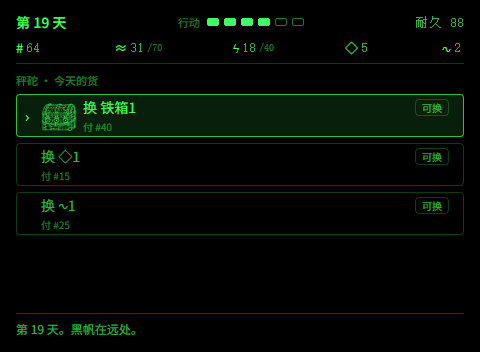 |
| 15-crew | 居民列表 · 珊瑚出海中 | 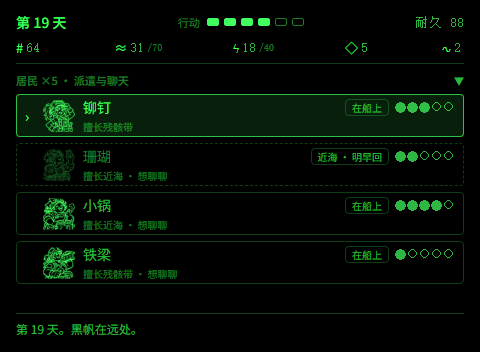 |
| 16-mate | 居民页 · 派遣海域 / 聊聊 | 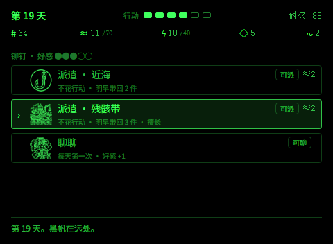 |
| 17-mate-nowater | 居民页 · 缺水不能派 | 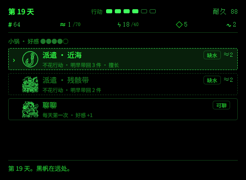 |
| 18-crew-back | 派遣归来并入早上的结算 | 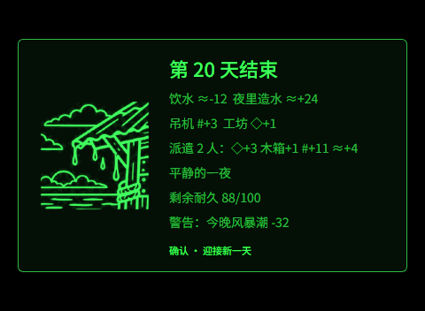 |
| 19-talk | 聊聊 · 平常 | 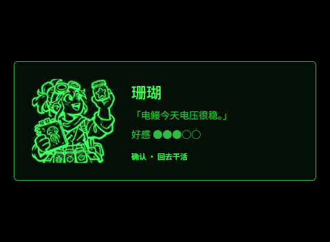 |
| 20-talk-warn | 聊聊 · 危险夜提醒 | 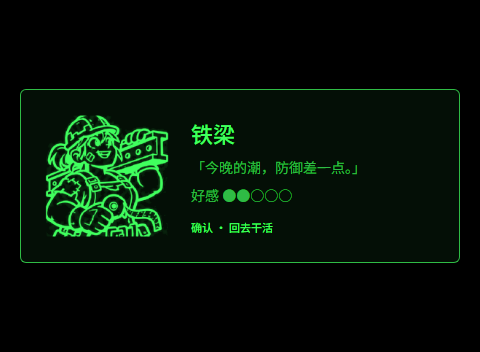 |
| 21-report | 每日结算 | 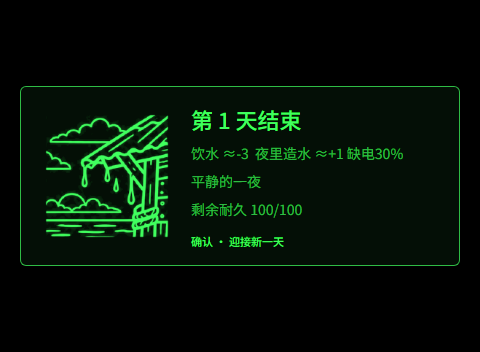 |
| 22-report-octopus | 结算 · 风暴潮 + 章鱼 | 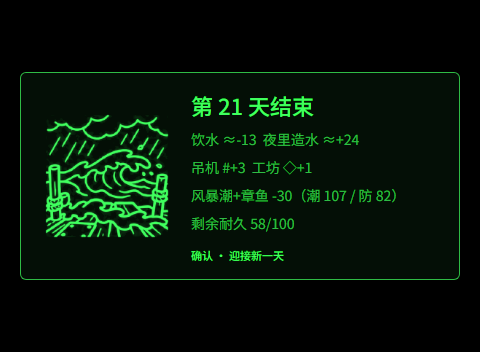 |
| 23-octopus | 剧情 · 巨型章鱼 |  |
| 24-raid | 海盗夜 · 打或交 | 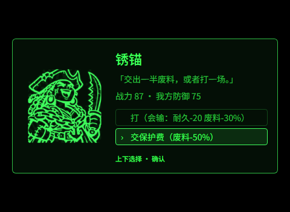 |
| 25-choice | 终章二选一 | 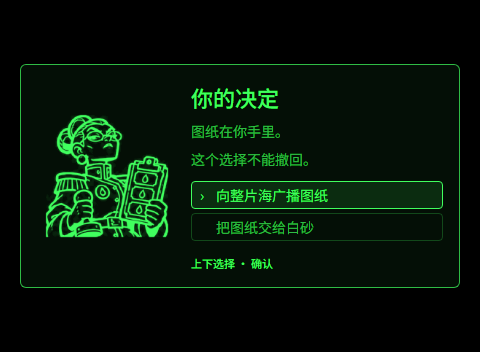 |
| 26-free | 自由漂流（广播结局后） | 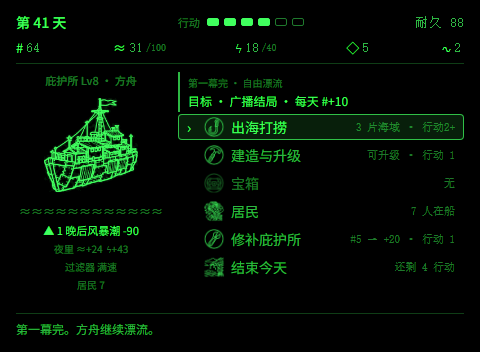 |
| 27-over | 沉没 · 从当天早上重来 | 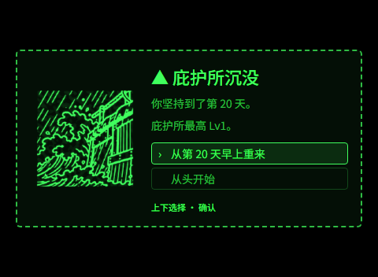 |
| 28-tired | 行动力用完 · 焦点在「结束今天」 | 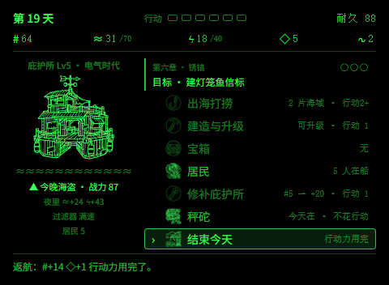 |
